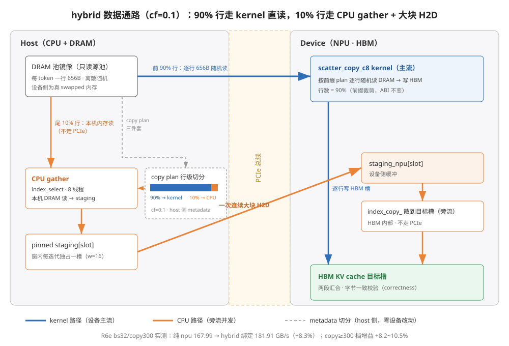
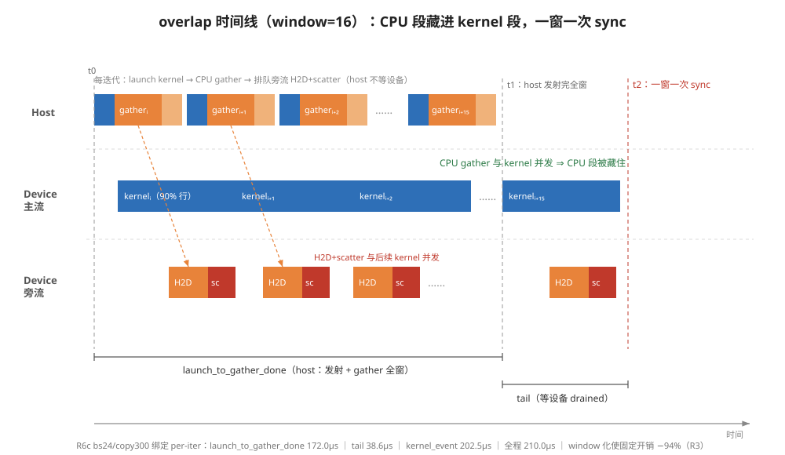
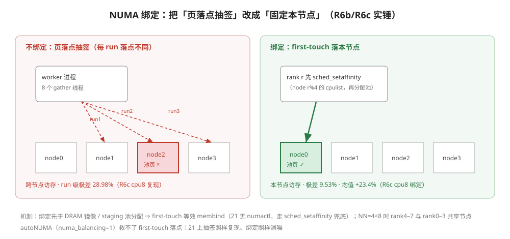
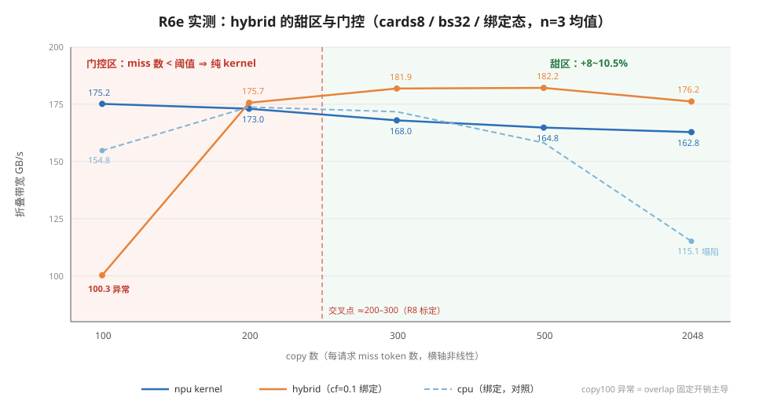

# 生产形态设计稿：hybrid 分流嵌入 vLLM DSA-offload 层间流水（蓝区，2026-10-15）

> 状态：**已解冻（R6c S2 强阳性）+ bs32 复证 3/5 档（R6e）**。R5 冻结口径：
> 最优 cf0.4 +3.99% 未达 ×1.05、repeat 极差 43~63% 不可复现。R6c（21 原坐标、
> NUMA 绑定形态）：hybrid cf0.1 cards8 绑定态折叠 180.019 GB/s ≥ 同轮
> anchor8 168.512×1.05=176.938（×1.068，+6.82%），绑定态极差 0.99% ⇒
> 强阳性。R6e（cards8/bs32 五 copy 档直接对比 + 旧脚本对账）：新旧等价
> 实锤（5 点全 ≤5%）；hybrid 绑定在 copy300/500/2048 复证强阳性
> （+8.2~10.5%，极差 ≤1.07%）；**copy100 异常低（~57%×npu）⇒ 生产形态
> 必须加 copy 数门控**（见 §0.7）。生产三件套：cf=0.1 + pretouch + NUMA
> 绑定（sched_setaffinity/numactl 任一）+ window 化发射。注意：稳态实得
> +6.8~10.5%，R5 高簇外推的 +26% 未兑现（成因未明，开放问题）。
>
> 证据链：R1（基线+亚线性）→ R2（S1 阴性，host 开销主导）→ R3（window=16
> 压 host 开销 -94%，S2 重开）→ R4（S2 弱阳性、缺页实锤 cards8、THP 有害、
> ρ* 0.25/0.20）→ R5（弱阳性维持、噪声收窄 NUMA）→ R6b（NUMA 实锤 cards4
> +12%）→ R6c（抽签原坐标实锤 + S2 强阳性）→ R6e（bs32 复证 3/5 档 +
> 新旧等价实锤 + copy100 门控发现）。全部数值见 pingpong.md 各轮判读节。

## 0. 机制详解：hybrid 到底怎么跑（代码走读 + 图示）

### 0.1 一句话

hybrid = **把每行回搬清单按行切两段**：前 (1−cf) 的 token 走 NPU kernel
（直读 DRAM over PCIe，与生产基线完全同路径），尾 cf 的 token 走 CPU
三段式（CPU gather → pinned staging → 一次连续大块 H2D → 设备侧
index_copy 散槽）。两段在**不同流上并发**（kernel 在主流，H2D+scatter
在旁流），window 化发射下一窗 16 次迭代只付一次 sync。

### 0.2 为什么能赢：带宽账

两条路径搬同一批离散 656B 行，成本结构不同：

| | kernel 路径（npu 方案） | CPU 路径（hybrid 的尾段） |
| --- | --- | --- |
| 读 DRAM | 设备逐行随机读，**每行走 PCIe** | host 本机内存读，**不走 PCIe** |
| 过 PCIe 的形态 | copy 数 × 656B 随机小事务 | **一次**连续大块 H2D |
| 写 HBM | kernel 内散写 | 设备侧 index_copy_（HBM 内部） |

前提查证：bench 的「DRAM 池」在设备侧是**真 swapped 内存**
（`torch_npu.empty_with_swapped_memory`，蓝图 `tests/_utils.py:21` 的
`swapped_from_cpu`，且显式拒绝用 HBM 冒充），host 侧另有同内容镜像
`dram_cpu`——所以「kernel 逐行走 PCIe / CPU 读本机」成立，正确性由
字节级校验兜底（`assert_copied` 对照 CPU reference 全量比对）。

收益来源：overlap 下 CPU 段被 kernel 段盖住（见 §0.4 时间线），全程 ≈
kernel 跑 (1−cf) 行的时间 < kernel 跑全量的时间 ⇒ 净赚约 cf 比例的
kernel 时间。实测稳态 +6.8%（bs24/copy300，R6c）~ +8.2~10.5%（bs32/
copy≥300，R6e）。约束条件：CPU 段时长必须 ≤ kernel 段——cf 不能大
（cf=0.1 是 R4/R5/R6 实测最稳点），copy 数不能太小（§0.7 门控）。



### 0.3 行级切分（`tests/scheme_workload.py:122`）

host 侧纯 metadata 操作，零设备端改动；kernel 拿到的是**严格前缀裁剪**
（ABI 与生产调用完全一致，只是 counts 变小），CPU 拿尾部：

```python
def split_hybrid(counts, src_rows, dst_rows, cpu_frac):
    """每行 copy 清单切两段：kernel 拿前缀，CPU 拿尾部。"""
    kernel_counts, kernel_src, kernel_dst, cpu_src, cpu_dst = [], [], [], [], []
    for count, src, dst in zip(counts, src_rows, dst_rows):
        n_cpu = round(count * cpu_frac)      # 本行给 CPU 的 token 数（cf=0.1 → 10%）
        kernel_counts.append(count - n_cpu)  # kernel 行数 = 前缀
        kernel_src.append(src[:count - n_cpu])
        kernel_dst.append(dst[:count - n_cpu])
        cpu_src.append(src[count - n_cpu:])  # CPU 拿尾部
        cpu_dst.append(dst[count - n_cpu:])
    return {...}
    # 两段的 dst 槽位天然不相交（每行 dst 列表本身唯一），无需额外协调
```

worker 侧把切分结果落成两套 metadata（`tests/test_scheme_worker.py:211`）：
kernel 三件套（`kernel_counts/src/dst`，padding 到 COPY_CAP 后上设备）+
CPU 尾部的物理行号（`cpu_phys_src/cpu_phys_dst`，`resolve_phys_rows` 用
block table 把 token id 翻译成物理行：`table[t//B]*B + t%B`）。

### 0.4 执行路径：双流 overlap（`tests/test_scheme_worker.py:308`）

```python
def hybrid_pass(case, mode):
    if mode == "serial":                      # 对照组：串行，无并发
        launch_kernel(case)                   #   kernel 跑 90% 行
        torch.npu.synchronize()
        cpu_full_pass(case)                   #   然后 CPU 段整个跑完
        torch.npu.synchronize()
        return
    # overlap：kernel 在主流（异步），host 紧接着做 CPU gather；
    # H2D+scatter 排到旁流，与 kernel 自己的 PCIe 读并发
    launch_kernel(case)                       # 主流：异步发射，host 不等
    cpu_gather(case)                          # host：本机 DRAM 读（与 kernel 并发）
    with torch.npu.stream(case.side_stream):  # 旁流：
        cpu_device_pass(case)                 #   一次连续 H2D + 设备侧散槽
    torch.npu.synchronize()
```

CPU 三段式的两阶段（`:280` / `:294`）：

```python
def cpu_gather(case, slot=0):
    """阶段1：从 DRAM 镜像 gather 到 pinned staging（host 内部，多线程）。"""
    src = case.cpu_phys_src                   # 尾 10% 行的物理行号
    case.staging[slot].copy_(case.dram_flat_cpu.index_select(0, src))
    # index_select 由 torch 多线程执行（--cpu-threads 8）；slot = 窗内槽位

def cpu_device_pass(case, slot=0):
    """阶段2：一次大块 H2D + 设备侧散到目标槽。"""
    dst = case.cpu_phys_dst_npu
    case.staging_npu[slot].copy_(case.staging[slot], non_blocking=True)  # 连续大块 H2D
    case.hbm_flat.index_copy_(0, dst, case.staging_npu[slot])            # HBM 内散槽
```

kernel 发射（`:267`）对 hybrid 只是换了前缀 metadata，调用本体与生产基线
逐字相同：

```python
def launch_kernel(case, counts_override=None):
    if case.kernel_counts is not None:        # hybrid：前缀三件套
        return vllm_dsa_a5.kvcache_scatter_copy_c8(
            case.hbm, case.dram, case.hbm_table, case.dram_table,
            case.kernel_src, case.kernel_dst, case.kernel_counts)
    ...                                       # npu 方案：完整三件套
```

时间线（overlap 的藏压机制）：



### 0.5 window=16 吞吐模式与相位口径

逐迭代 sync 的固定开销曾是 cpu/hybrid 的死因（R2：copy0 纯开销
69~114µs，占 83%）。window 化（`:475` `time_hybrid`）让 host 一窗发射
16 次迭代、只付一次 sync，每迭代独占一个 staging slot 互不踩：

```python
while done < args.iters:
    w = min(args.window, args.iters - done)   # 本窗迭代数（16）
    t0 = time.perf_counter_ns()
    start.record()                            # 主流 event 起点
    for slot in range(w):                     # host 连续发射一窗：
        launch_kernel(case)                   #   主流 kernel（异步）
        cpu_gather(case, slot)                #   host gather（独占 slot）
        with torch.npu.stream(case.side_stream):
            cpu_device_pass(case, slot)       #   旁流 H2D+scatter（异步）
    t1 = time.perf_counter_ns()               # host 发射完（设备还在跑）
    end.record()
    torch.npu.synchronize()                   # 一窗一次 sync
    t2 = time.perf_counter_ns()               # 设备 drained
```

R3 实测：copy0 固定开销 69~114µs → 5~7µs（**-94%**），hybrid 的
h2d_scatter_tail 仅 5.4µs——CPU 段基本被 kernel 段藏住，S2 由此重开。

相位口径（`performance.phases`，per-iter 均值）：

| 字段 | 含义 |
| --- | --- |
| `launch_to_gather_done_us` | t0→t1：host 发射 w 个 kernel + 完成 w 次 gather + 排队 w 次旁流的墙钟 |
| `h2d_scatter_tail_us` | t1→t2：host 发射完后等设备 drained 的尾巴 |
| `kernel_event_us` | 主流 event 计时（kernel 段设备侧时间） |

R6c 绑定 r1（bs24/copy300）：172.0 / 38.6 / 202.5，全程 210.0µs。

### 0.6 pretouch 与 NUMA 绑定（生产三件套之二、三）

```python
def _pretouch(tensor):                        # :169
    flat = tensor.view(-1)
    flat[::4096] += 0    # 每 4K 页读写一次 ⇒ 启动期把缺页中断付掉
```

```python
def apply_numa_fallback():                    # :100（21 无 numactl 的兜底路径）
    """绑定发生在 DRAM 镜像/staging 池分配之前 ⇒ first-touch 等效 membind。"""
    node = os.environ.get(NUMA_FALLBACK_ENV, "").strip()
    if not node:
        return
    cpus = _node_cpulist(node)                # /sys/.../node<N>/cpulist
    os.sched_setaffinity(0, cpus)             # 进程绑到该节点全部核
```

- **缺页实锤（R4，cards8 限定）**：pretouch 使 cpu_gather 段 -46.2%；
  小池（cards1）无效应但无害。生产中池是常驻的，pretouch 只在启动期
  付一次，稳态净赚 ⇒ 纳入默认。
- **NUMA 实锤（R6b/R6c/R6e）**：不绑定时池页落点逐 run 抽签（R6c cpu8
  不绑定极差 28.98%），绑定后消噪（9.53%）且均值 +23.4%；R6b（13 机
  cards4）呈稳定均值差 +11.97%，增益落 gather 段（-19.7%）⇒ 机制闭环：
  收益来自「gather 线程与池页同节点」。⇒ 绑定纳入默认（numactl 或
  sched_setaffinity 兜底任一）。注意 21 的 autoNUMA（numa_balancing=1）
  救不了 first-touch 落点。
- **THP 严禁 always**（R4：cards8 gather +31.7%、总时 +25.1%，有害），
  维持 madvise。



### 0.7 实测全景与 copy 数门控（R6e 新增）

cards8/bs32 五 copy 档直接对比（折叠带宽 GB/s，n=3 均值）：

| copy | 旧脚本 | 新 npu | cpu 绑定 | hybrid 绑定 | hybrid vs npu |
| --- | --- | --- | --- | --- | --- |
| 100 | 170.62 | 175.19 | 154.79 | **100.31** | **-42.7%** |
| 200 | 166.95 | 173.02 | 173.78 | 175.68 | +1.5% |
| 300 | 165.60 | 167.99 | 171.72 | **181.91** | **+8.3%** |
| 500 | 164.16 | 164.82 | 158.16 | **182.18** | **+10.5%** |
| 2048 | 163.89 | 162.83 | 115.13 | **176.24** | **+8.2%** |

- **新旧等价实锤**：旧脚本 vs 新 bench 5 点差 ≤3.6% ⇒ harness 改写无回归。
- **甜区 copy≥300**：双条件（≥锚×1.05 且极差 ≤10%）三档全中，与 R6c
  （bs24/copy300 +6.8%）互洽。
- **copy100 异常**：hybrid 绑定三 run 99.13/100.59/101.22 稳定低值
  （不绑定同低）——copy 数小时 cf=0.1 只分给 CPU ~10 token/请求，
  overlap 的发射/旁流固定开销藏不住，反拖整体。⇒ **生产形态必须门控：
  miss 数低于阈值回退纯 kernel**；阈值待 R8 扫描标定（候选 copy∈
  {100,150,200,250,300} 找拐点，下图交叉区 200~300）。
- **cpu 全量方案大 copy 档出局**：copy2048 绑定也塌到 115.13（全量
  gather 43MB/die/iter）；cpu-delta（只搬 miss 增量的驻留路线）不受此限。



## 1. 集成点（vLLM-ascend-DSA 现状映射）

生产链路与 bench 方案的对应关系：

| bench 方案 | 生产算子/路径（vllm_ascend/dsa_offload/ops.py） |
| --- | --- |
| npu（S0 基线） | `a5_kvcache_scatter_copy_c8`（纯回搬 kernel，:283）或其融合形态 `a5_fused_copy_sfa_copy_stage`（:304）/ `fused_copy_sfa_c8`（:518，copy+MTP QSFA 单次 MIX launch） |
| cpu（S1） | 无对应——生产当前没有 CPU gather 路径；本稿即提案 |
| hybrid（S2） | copy plan 行级切分：前 1-cf 行走 kernel（融合 copy stage），尾 cf 行走 CPU gather→大块 H2D→设备侧 scatter，旁流并发 |

层间上下文：`DSALayerOffloadContext`（runtime.py:854）逐层执行
`execute_decode_selection`（lightning indexer top-k 选出回搬 token）→
copy stage → `execute_sparse_attention`。hybrid 只改 copy stage 的内部
实现，对上（selection）对下（SFA）接口不变。

## 2. 分流设计（copy plan 行级切分）

- **切分点**：copy plan（`copy_src_ids/dst_slots/copy_counts`，语义与
  bench 完全一致：BLOCK=128、COPY_CAP=16384、-1 填充）按行切两段——
  前 `ceil(rows×(1-cf))` 行走 kernel，尾部走 CPU。切分在 host 侧
  metadata 组装时完成，零设备端改动（bench 侧实现见 §0.3）。
- **集成面已核实**（2026-10-15 读码，vLLM-ascend-DSA）：runtime 当前全部
  copy 走独立 kernel `a5_kvcache_scatter_copy_c8`，**仅两处调用点**
  （runtime.py:944 `execute_decode_selection`、runtime.py:1044
  `execute_shared_decode_selection`），参数同为三件套
  `(topk_index, topk_slots, miss_count)`——hybrid 切分 = 三件套用同一
  行界 K 切片，K 按 `copy_counts` 累计值反解使 CPU 份额 ≈cf（bench
  scheme_workload.py 的 hybrid 切分即此逻辑）。**融合算子
  `fused_copy_sfa_c8` 已注册但尚无生产调用点**（仅 ops.py 定义 +
  contracts.py 注释提及），故本稿的集成目标是独立 kernel 路径，
  无 MIX 核内资源配比问题（见 §5.4 的残留风险）。
- **cf 推荐值**：**0.1（静态）**。依据 R4：延迟口径 cf0.1 全档最稳
  （avg_us_mean 212.06 / avg_us_max 219.55，max/mean 仅 1.04；cf0.4 吞吐
  略高但 max/mean 1.22 有长尾）。生产 decode 对尾延迟敏感，取稳不取尖。
- **copy 数门控（R6e 新增，必需）**：每请求 miss token 数低于阈值时
  **不走 hybrid、回退纯 kernel**——R6e 实测 copy100 档 hybrid 只有
  npu 的 ~57%（overlap 固定开销主导，§0.7）。阈值由 R8 扫描标定
  （候选拐点区间 200~300）。实现上只是切分函数的一个早退分支。
- **CPU 段形态**（即 bench S1 路径的生产化）：CPU 多线程从 DRAM 池镜像
  gather 到 pinned staging → 一次大块 H2D → 设备侧 index_copy 散到目标槽。
  staging 复用、每 4K 页 pretouch（见 §4）。
- **旁流并发**（overlap 语义）：kernel 在主流，H2D+scatter 在旁流；
  R3 实测 w16 下 hybrid 的 h2d_scatter_tail 仅 5.4µs，CPU 段基本被
  kernel 段藏住——这是 hybrid 能翻正的机制（实测，非推测）。

## 3. 层间流水（window 语义的生产映射）

bench 的 `--window 16`（每窗口 16 迭代共享一次同步，每迭代独占 staging
slot）压掉了 host 固定开销（copy0 69~114µs→5~7µs，-94%，R3 实测）。
生产映射不是「16 层共享同步」，而是：

- decode 每层一次 copy stage launch；**同步点放在 attention 之后、下一层
  selection 之前**（生产本来就有的层间依赖点），copy stage 的 launch →
  完成事件全部异步化，host 不逐层 sync。
- staging slot 数 = 在飞层数上限（≥2 即可流水，bench 用 16 是压测极端
  化；生产取 2~4 双/四缓冲即可，待 R6+ 实测标定）。
- 与 `fused_copy_sfa_c8` 的关系：融合 kernel 把 copy+QSFA 并成一次 MIX
  launch，层间流水点随之移到「融合 kernel launch 之后」。hybrid 的 CPU
  段仍可旁流先行（它不依赖融合 kernel），两段汇合于 attention 输入。

## 4. 系统配置（R4/R6 实测写死）

- **pretouch 纳入默认**：DRAM 池镜像 + staging 在 worker 启动时全量摸页
  （R4 cards8 缺页实锤：cpu_gather -46.2%；小池无效应但无害）。生产中池
  是常驻的，pretouch 成本只付一次（启动期），稳态净赚。
- **THP 维持 madvise，严禁 always**（R4：THP=always 使 cards8 gather
  +31.7%、总时 +25.1%，显著有害）。
- **NUMA 绑定纳入默认（R6 实锤，原「未测」口径作废）**：worker 绑定到
  本卡 NUMA 节点（numactl 或 sched_setaffinity 兜底任一，绑定必须先于
  池分配 ⇒ first-touch 等效 membind）。实测：R6b cards4 +11.97%（增益
  落 gather 段 -19.7%）；R6c cards8 消噪（不绑定极差 28.98% → 绑定
  9.53%）且均值 +23.4%（cpu8）、+6.7%（hybrid8）；R6e 复核维持（cpu
  copy300 +19.8%，hybrid 全档无 >10% 反向）。autoNUMA 不能替代绑定。
  节点数 < 卡数时按 `rank→nodes[rank%NN]` 循环映射（共享节点形态已
  标注，不与 NN≥8 混比）。

## 5. 风险与开放问题

1. ~~收益存疑~~（已消解）：R6c S2 强阳性（×1.068、极差 0.99%），R6e
   bs32 三档复证（+8.2~10.5%、极差 ≤1.07%）；收益在甜区坐标内实锤。
2. **cards4 不成立**：hybrid 优势目前仅 cards8 实测成立；cards4 未过锚
   （跨轮+漂移史）。生产部署若卡数 ≠8 需重新标定 cf。
3. **cards8 长尾**：copy300 档 avg_us_max/mean 最高 1.29（D 组），hybrid
   cf0.1 档最稳（1.04）——极端 run 的尾延迟行为仍未表征。
4. **融合 kernel 的切分代价未知（残留风险）**：读码确认融合算子
   尚无生产调用点，故独立 kernel 路径的 hybrid 集成不触及 MIX 形态问题；
   但若未来切到 `fused_copy_sfa_c8`，切分后 kernel 侧 rows 减 10% 对 MIX
   形态（copy 与 attention 的核内资源配比）的影响仍未测——届时需要一轮
   融合形态实测。
5. **ρ 敏感性**：breakeven 模型 ρ*（copy300）=0.25/0.20（cards1/8）——
   hybrid 收益前提是回搬量占池子的比例 ρ 足够低或 churn 稳态驻留够高；
   若业务 ρ 形态剧变（长上下文整体换入换出），结论需重估。
6. **copy 数门控阈值未标定（R6e 新增）**：copy100 档 hybrid 稳定
   -42.7%，门控已是生产必需（§2）；阈值拐点（目测 200~300 之间）待
   R8 扫描定标。
7. **+26% 高簇未兑现**：R5 cf0.4 偶发 216/217 GB/s 两 run 的成因未明；
   稳态收益按 +6.8~10.5% 计，高簇不阻塞但列为开放问题。

## 6. 验证路线（派单队列）

- ~~R5~~（已交付+判读）：弱阳性维持，噪声收窄到 NUMA。
- ~~R6b/R6c~~（已交付+判读）：NUMA 实锤 + 绑定=修复 + S2 强阳性解冻。
- ~~R6e~~（已交付+判读）：bs32 复证 3/5 档 + 新旧等价实锤 + copy100
  门控发现。
- R7（在队列）：队列深度扫描（drafts/R5_queue_depth.md 改编号）查 npu
  侧余量。
- R8（新增候选）：copy 数门控阈值扫描（copy∈{100,150,200,250,300}×
  hybrid±绑定），定门控拐点。
- 生产化判决性实验（解冻后）：vLLM 仓内独立 kernel 路径集成实测——
  两处调用点（runtime.py:944/:1044）接入行级切分（cf=0.1 + 门控），
  e2e decode 延迟对比不切分基线。
